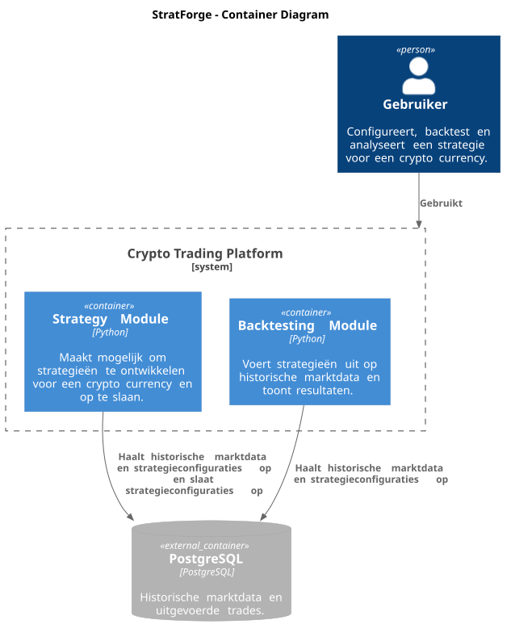
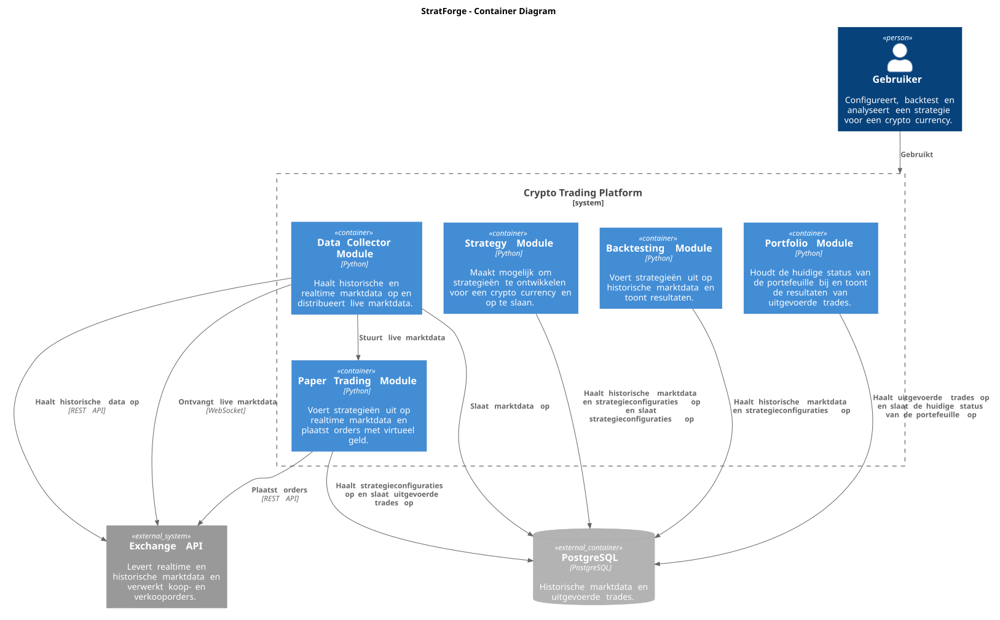

# Haalbaarheid van het integreren van Paper Trading binnen StratForge

**Onderzoeksdocument – StratForge**  
**Onderzoeksdatum:** 17 november 2026  
**Onderzoeksgebied:** Technische haalbaarheid en architectuur van Paper Trading

---

## 1. Inleiding

StratForge is een cryptocurrency backtestingplatform waarmee gebruikers tradingstrategieën kunnen configureren en evalueren op basis van historische marktdata. Gebruikers kunnen een cryptocurrency selecteren, een strategy principle kiezen, de bijbehorende features en parameters instellen en vervolgens een backtest uitvoeren. De resultaten worden onder andere weergegeven met grafieken, performance-indicatoren en een overzicht van uitgevoerde trades.

De huidige applicatie richt zich volledig op historische backtesting. Een mogelijke uitbreiding is het toevoegen van **Paper Trading**. Hiermee kunnen gebruikers hun strategieën testen op basis van actuele marktdata, zonder daadwerkelijk cryptocurrency te kopen of verkopen. Orders en transacties worden intern gesimuleerd met virtueel kapitaal.

Paper Trading kan een waardevolle aanvulling zijn op backtesting. Een strategie die goede resultaten behaalt op historische data, hoeft namelijk niet automatisch hetzelfde gedrag te vertonen wanneer deze wordt toegepast op actuele marktdata. Met Paper Trading kunnen gebruikers onderzoeken hoe een strategie zich onder actuele marktomstandigheden gedraagt.

Dit onderzoek richt zich op de technische en functionele haalbaarheid van deze uitbreiding binnen StratForge.

## 2. Huidige situatie

### 2.1 Bestaande applicatie

De huidige versie van StratForge bestaat uit:

- **Strategy Module:** beheert strategieprincipes en strategieconfiguraties.
- **Backtesting Module:** functionaliteit voor het configureren en uitvoeren van strategieën op historische marktdata.
- **PostgreSQL Database:** slaat onder andere historische marktdata en strategieconfiguraties op.

De historische marktdata is verzameld en in de PostgreSQL database geplaatst met behulp van eenmalig uitgevoerde scripts. Er is momenteel geen doorlopende service die automatisch nieuwe marktdata ophaalt of verwerkt.

### 2.2 Onderdelen die nog niet bestaan

Het is belangrijk onderscheid te maken tussen de bestaande implementatie en eerder ontworpen architectuurconcepten.

De volgende onderdelen zijn nog niet geïmplementeerd:

**Data Collector Module**

Een Data Collector Module is eerder als concept opgenomen in het contextmodel. Deze module zou verantwoordelijk zijn voor het verzamelen van historische en realtime marktdata via een exchange-API. In de huidige applicatie bestaat deze module echter nog niet. De historische data is uitsluitend via eenmalige scripts geïmporteerd.

**Automated Trading Module**

Ook de Automated Trading Module was onderdeel van een eerder conceptueel contextmodel. Deze module zou verantwoordelijk zijn voor het uitvoeren van strategieën op actuele marktdata en het plaatsen van orders. Deze functionaliteit is nog niet gerealiseerd.

Het eerdere contextmodel moet daarom niet worden geïnterpreteerd als een weergave van de huidige softwarearchitectuur. Het beschrijft mogelijke toekomstige functionaliteit.

### 2.3 Aanleiding voor de uitbreiding

De huidige backtestingfunctionaliteit maakt het mogelijk om strategieën te evalueren op basis van historische marktdata. Een volgende stap is onderzoeken hoe gebruikers deze strategieën kunnen testen op actuele marktdata.

Paper Trading biedt hiervoor een geschikte tussenstap. Het moet het mogelijk maken om:

- Strategieën te testen op actuele marktbewegingen.
- De gegenereerde BUY- en SELL-signalen te observeren.
- De gesimuleerde uitvoering van orders te beoordelen.
- De ontwikkeling van een virtuele portfolio te volgen.
- Backtestresultaten te vergelijken met resultaten uit Paper Trading.

Hierbij worden geen echte orders naar een exchange verstuurd.

## 3. Probleemstelling

StratForge biedt momenteel alleen de mogelijkheid om tradingstrategieën te evalueren op historische marktdata. Hierdoor ontbreekt de mogelijkheid om te onderzoeken hoe dezelfde strategieën zich gedragen wanneer ze worden toegepast op actuele marktdata.

Er moet worden onderzocht hoe realtime marktdata kan worden geïntegreerd, hoe strategieën continu kunnen worden uitgevoerd en hoe orders en portfolioveranderingen realistisch kunnen worden gesimuleerd.

Daarnaast moet worden bepaald welke exchange geschikt is voor het leveren van realtime marktdata. Hierbij zijn onder andere de beschikbare handelsparen, API-functionaliteit, WebSocket-ondersteuning, toegankelijkheid vanuit Nederland en eventuele kosten relevant.

## 4. Onderzoeksdoel

Het doel van dit onderzoek is om vast te stellen hoe Paper Trading technisch en functioneel kan worden geïntegreerd binnen StratForge.

Het onderzoek moet leiden tot:

1. Inzicht in de technische mogelijkheden van verschillende cryptocurrency exchanges.
2. Een onderbouwde keuze voor een geschikte exchange en bijbehorende API.
3. Inzicht in de benodigde architectuur voor realtime marktdata en Paper Trading.
4. Een ontwerp voor het simuleren van orders, transacties en portfolioveranderingen.
5. Een Proof of Concept waarmee de haalbaarheid van Paper Trading wordt aangetoond.

## 5. Onderzoeksvraag

**Hoofdvraag**

Hoe kan Paper Trading worden geïntegreerd binnen StratForge, zodat gebruikers hun bestaande tradingstrategieën kunnen testen op actuele cryptocurrency-marktdata zonder daadwerkelijk financiële transacties uit te voeren?

**Deelvragen**

1. Welke technische en functionele vereisten zijn noodzakelijk om Paper Trading binnen StratForge te realiseren?
2. Welke cryptocurrency exchanges bieden geschikte API's voor het ophalen van realtime marktdata?
3. Welke exchange is het meest geschikt voor de applicatie, rekening houdend met API-functionaliteit, handelsparen en toegankelijkheid vanuit Nederland?
4. Hoe kan de bestaande strategiefunctionaliteit worden hergebruikt voor het continu verwerken van realtime marktdata?
5. Hoe kunnen orders, transacties, kosten en portfolioveranderingen realistisch worden gesimuleerd?
6. Welke aanpassingen zijn nodig aan de bestaande softwarearchitectuur en database?
7. Hoe kan met een Proof of Concept worden aangetoond dat de gekozen oplossing correct functioneert?

## 6. Onderzoeksafbakening

Om het onderzoek beheersbaar te houden, wordt de eerste implementatie beperkt tot een Proof of Concept.

| Onderdeel              | Afbakening                                          |
| ---------------------- | --------------------------------------------------- |
| Cryptocurrency         | Bitcoin (BTC)                                       |
| Strategy principle     | Principes o.b.v. één currency e.g.: Trend Following |
| Market data            | Realtime marktdata                                  |
| Exchange Platform      | Eén geselecteerde exchange platform                 |
| Trading                | Uitsluitend Paper Trading                           |
| Ordertype              | Market orders                                       |
| Kapitaal               | Virtueel startkapitaal                              |
| Portfolio              | Eén virtuele portfolio                              |
| Uitvoering             | Interne simulatie, geen echte orders                |
| Pairs Trading          | Buiten scope                                        |
| Multi-exchange support | Buiten scope                                        |
| Live trading           | Buiten scope                                        |

De keuze voor Bitcoin en principes o.b.v. één currency zorgt ervoor dat de Proof of Concept zich richt op het realiseren van de benodigde infrastructuur en het realtime uitvoeren van een bestaande strategie, zonder dat meerdere cryptocurrencies of complexe strategieprincipes de scope vergroten.

---

## 7. Huidige en voorgestelde architectuur

### 7.1 Huidige architectuur

De huidige architectuur bestaat uit een React-frontend, een FastAPI-backend en een PostgreSQL-database.

De backend verwerkt onder andere strategieconfiguraties en backtestverzoeken. De historische marktdata wordt uit PostgreSQL opgehaald en gebruikt voor het uitvoeren van backtests.

De huidige gegevensstroom kan als volgt worden weergegeven:

1. De gebruiker configureert een strategie in de React-frontend.
2. De frontend verstuurt de configuratie naar de FastAPI-backend.
3. De backend verwerkt het verzoek en haalt de benodigde historische marktdata uit PostgreSQL.
4. De backtestingfunctionaliteit voert de strategie uit op de historische data.
5. De resultaten worden teruggestuurd naar de frontend en gevisualiseerd.

Er is geen realtime dataverzameling aanwezig. Ook bestaat er nog geen afzonderlijke Paper Trading- of Automated Trading-module.

### 7.2 Voorgestelde architectuur

Voor de uitbreiding met Paper Trading zijn nieuwe componenten nodig. De bestaande functionaliteit voor strategieconfiguratie en backtesting blijft behouden.

De voorgestelde architectuur bestaat uit:

**Frontend (React)**

De frontend wordt uitgebreid met een Paper Trading-interface. Gebruikers kunnen een strategie starten, pauzeren en stoppen en de resultaten van de virtuele portfolio bekijken.

**Backend (FastAPI)**

De bestaande backend wordt uitgebreid met API-endpoints en services voor Paper Trading, realtime marktdata en portfolio-informatie.

**Data Collector Module (nieuw)**

Deze module wordt verantwoordelijk voor het ophalen en verwerken van realtime marktdata via de API van de geselecteerde exchange. Voor realtime updates kan gebruik worden gemaakt van WebSockets.

**Strategy Module (bestaand, uit te breiden waar nodig)**

De bestaande strategiefunctionaliteit wordt hergebruikt. De strategie moet niet alleen historische candles kunnen verwerken, maar ook nieuwe marktdata ontvangen en op basis daarvan signalen genereren.

**Backtesting Module (bestaand)**

De bestaande backtestingfunctionaliteit blijft verantwoordelijk voor het uitvoeren van strategieën op historische marktdata.

**Paper Trading Module (nieuw)**

Deze module ontvangt realtime signalen en verwerkt deze via een interne execution simulator. Er worden geen echte orders naar de exchange verstuurd.

**Portfolio & Performance Module (nieuw)**

Deze module beheert de virtuele balans, posities, transacties en performancegegevens.

**PostgreSQL (bestaand, uit te breiden)**

De bestaande database wordt uitgebreid met tabellen voor Paper Trading-accounts, orders, fills, posities en portfoliohistorie.

### 7.3 Architectuurdiagram

Het volgende diagram beschrijft de voorgestelde situatie na implementatie. De nieuwe componenten zijn dus onderdelen die nog ontwikkeld moeten worden.

### 7.4 Belangrijk architectuurprincipe: gedeelde strategie, gescheiden uitvoering

Een belangrijk uitgangspunt is dat de bestaande strategiefunctionaliteit zoveel mogelijk hergebruikt wordt.

De logica die bepaalt wanneer een strategie een BUY- of SELL-signaal genereert, moet onafhankelijk zijn van de manier waarop een order wordt uitgevoerd.

Daarom wordt onderscheid gemaakt tussen:

- **Strategy Module:** bepaalt op basis van marktdata welke signalen worden gegenereerd.
- **Backtesting Module:** simuleert de uitvoering van signalen op historische data.
- **Paper Trading Module:** simuleert de uitvoering van signalen op realtime marktdata.

Hiermee kan dezelfden strategie in beide omgevingen worden gebruikt. Alleen de marktdata en de executionomgeving verschillen.

Dit voorkomt dat dezelfde strategielogica op twee verschillende plaatsen moet worden onderhouden.

---

## 8. Onderzoeksmethode

Voor het onderzoek worden verschillende CMD- en ICT-onderzoeksmethoden gecombineerd.
### 8.1 Expert Interview

Het Expert Interview wordt gebruikt om kennis te verzamelen van iemand met relevante ervaring op het gebied van cryptocurrency trading, exchange-API's, algoritmische handel of softwarearchitectuur.

**Doel**

Inzicht verkrijgen in de technische en praktische aandachtspunten bij het ontwikkelen van een Paper Trading-systeem.

**Selectie van een expert**

De expert moet bij voorkeur ervaring hebben met één of meerdere van de volgende onderwerpen:

- Cryptocurrency exchanges.
- Algorithmic trading.
- Order execution en orderboeken.
- Tradingstrategieën en backtesting.

**Uitvoering**

Het interview wordt semigestructureerd uitgevoerd en duurt naar verwachting 30 tot 60 minuten. De vragen worden vooraf opgesteld, maar er is ruimte om door te vragen op relevante onderwerpen.

**Interviewvragen**

1. Welke technische onderdelen zijn volgens u noodzakelijk voor een betrouwbaar Paper Trading-systeem?
2. Welke verschillen zijn er tussen historische backtesting en Paper Trading op realtime marktdata?
3. Welke exchange-API's zijn volgens u geschikt voor het ophalen van realtime Bitcoin-marktdata?
4. Welke factoren zijn belangrijk bij het simuleren van de uitvoering van market orders?
5. Hoe belangrijk zijn spread, slippage en trading fees voor een realistische simulatie?
6. Is het noodzakelijk om orderboekdata te gebruiken, of is realtime tickerdata voldoende voor een eerste Proof of Concept?
7. Hoe voorkomt u dat een strategie meerdere orders uitvoert op basis van hetzelfde signaal?
8. Hoe zou u omgaan met WebSocket-verbindingsproblemen en ontbrekende marktdata?
9. Welke gegevens moeten worden opgeslagen om Paper Trading-resultaten achteraf te kunnen analyseren?
10. Welke architectuur zou u adviseren voor een systeem waarin backtesting en Paper Trading dezelfde strategiefunctionaliteit gebruiken?

De antwoorden worden thematisch geanalyseerd. Daarbij worden terugkerende onderwerpen, technische aanbevelingen en mogelijke risico's vastgelegd.

### 8.2 Available Product Analysis

De technische mogelijkheden van de verschillende exchanges worden onderzocht aan de hand van officiële API-documentatie (Library onderzoek).

Hierbij wordt onder andere gekeken naar:

- Beschikbare BTC-markten.
- REST API-functionaliteit.
- WebSocket-functionaliteit.
- Realtime tickerdata.
- Trades en orderboekdata.
- Authenticatievereisten.
- Rate limits.
- Beschikbaarheid vanuit Nederland.
- Eventuele kosten.

De geselecteerde exchanges worden vergeleken aan de hand van een vaste set requirements.

De vergelijking is bedoeld om een geschikte databron voor de applicatie te kiezen. Het feit dat een exchange een API aanbiedt, betekent niet automatisch dat alle functionaliteit of accountdiensten in Nederland beschikbaar zijn.

### 8.3 Technisch experiment

Na de documentanalyse wordt een klein technisch experiment uitgevoerd met de API van de meest geschikte exchange.

Het experiment moet aantonen dat:

1. Een verbinding met de exchange kan worden opgezet.
2. Realtime BTC-marktdata ontvangen kan worden.
3. De ontvangen data correct kan worden verwerkt.
4. De data aan de strategiefunctionaliteit kan worden aangeboden.
5. De verbinding opnieuw kan worden opgebouwd na een onderbreking.

### 8.4 Proof of Concept

De laatste stap is het realiseren van een beperkte Paper Trading-implementatie voor BTC en Trend Following.

Hiermee wordt onderzocht of de voorgestelde architectuur in de praktijk werkt.

---

## 9. Vergelijking van cryptocurrency exchanges

Voor Paper Trading is een exchange nodig die betrouwbare realtime marktdata beschikbaar stelt. Omdat er geen echte orders worden geplaatst, is het in eerste instantie voldoende om toegang te hebben tot publieke marktdata.

De exchange hoeft voor deze Proof of Concept dus niet noodzakelijk een account te bieden waarmee daadwerkelijk gehandeld kan worden. Wel moet de benodigde marktdata toegankelijk zijn.

### 9.1 Kraken

Kraken biedt REST- en WebSocket-API's.

De publieke WebSocket-API ondersteunt onder andere:

- Tickerdata.
- Trade-updates.
- OHLC-data.
- Orderboekdata.
- Spread-informatie.

Voor Bitcoin tegen Amerikaanse dollars gebruikt Kraken de API-marktnaam `XBT/USD`. In de gebruikersinterface wordt dit doorgaans weergegeven als BTC/USD.

Een belangrijk voordeel is dat de publieke WebSocket-marktdata zonder authenticatie toegankelijk is. De REST API kan daarnaast worden gebruikt voor historische marktgegevens.

**Beoordeling:** Kraken is een sterke kandidaat wanneer BTC/USD als markt gewenst is.

### 9.2 Bitvavo

Bitvavo biedt REST- en WebSocket-API's voor marktdata en tradingfunctionaliteit.

De relevante mogelijkheden zijn onder andere:

- Realtime tickerdata.
- Best bid/ask.
- Orderboekupdates.
- Trades.
- Marktinformatie.

Voor Bitcoin gebruikt Bitvavo onder andere het handelspaar BTC-EUR.

Een voordeel van Bitvavo is de Nederlandse marktcontext. Dit maakt de exchange interessant wanneer de applicatie primair op gebruikers in Nederland is gericht.

**Beoordeling:** Bitvavo is een sterke kandidaat wanneer BTC-EUR de voorkeur heeft.

### 9.3 Coinbase

Coinbase biedt een WebSocket-feed voor realtime marktdata.

De API ondersteunt onder andere:

- Tickerupdates.
- Tradegegevens.
- Level 2 orderboekdata.

Dit maakt Coinbase technisch interessant voor een Paper Trading-systeem waarin realtime prijsinformatie en orderboekdata belangrijk zijn.

De exacte beschikbare handelsproducten en toegankelijkheid voor Nederlandse gebruikers moeten vooraf worden gecontroleerd.

**Beoordeling:** Coinbase is een relevante kandidaat vanwege de beschikbare realtime marktdata en orderboekfunctionaliteit.

### 9.4 Hyperliquid

Hyperliquid biedt API-functionaliteit voor spotmarkten en perpetual futures.

Een belangrijk onderscheid is dat de spotmarkt en perpetualmarkt verschillende instrumenten en handelsmechanismen gebruiken.

Voor Bitcoin geldt:

- De spotmarkt wordt in de interface weergegeven als BTC/USDC.
- Intern wordt de spotmarkt op HyperCore aangeduid met het tokenpaar `UBTC/USDC`.
- De perpetualmarkt gebruikt BTC als instrument en USDC als onderpand.

Hyperliquid biedt dus wel Bitcoin-marktdata, maar geen conventioneel BTC/USD fiat-spotpaar zoals Kraken.

Voor een Paper Trading-systeem moet bovendien duidelijk worden bepaald of de applicatie een spotstrategie of een perpetualstrategie simuleert. Deze hebben verschillende eigenschappen, bijvoorbeeld door het gebruik van funding payments bij perpetual futures.

**Beoordeling:** Hyperliquid is een interessante kandidaat wanneer BTC/USDC of BTC-perpetuals gewenst zijn, maar minder geschikt wanneer de Proof of Concept specifiek op BTC/USD-spot gericht is.

### 9.5 Vergelijking

| Exchange    | BTC-markt                                              | API       | Realtime data             | Relevantie                           |
| ----------- | ------------------------------------------------------ | --------- | ------------------------- | ------------------------------------ |
| Kraken      | XBT/USD, BTC/EUR                                       | REST + WS | Ticker, trades, orderboek | Zeer geschikt                        |
| Bitvavo     | BTC-EUR                                                | REST + WS | Ticker, trades, orderboek | Zeer geschikt                        |
| Coinbase    | BTC-markten, exacte productbeschikbaarheid controleren | REST + WS | Ticker, Level 2           | Geschikt                             |
| Hyperliquid | BTC/USDC spot en BTC perpetual                         | REST + WS | Marktdata en orderboek    | Geschikt voor crypto-quote/perpetual |

*Deze vergelijking is een eerste technische beoordeling op basis van de beschikbare documentatie. De exacte markttoegang, productbeschikbaarheid, API-limieten en eventuele kosten moeten tijdens het technische experiment worden geverifieerd.*

### 9.6 Voorlopige conclusie exchangekeuze

Op basis van de huidige vergelijking zijn Kraken en Bitvavo de meest voor de hand liggende kandidaten voor de Proof of Concept.

- Kraken is interessant vanwege het BTC/USD-handelspaar en de publieke WebSocket-marktdata.
- Bitvavo is interessant vanwege BTC-EUR, de Nederlandse context en de beschikbare realtime API-functionaliteit.
- Coinbase is een alternatief vanwege de realtime ticker- en Level 2-functionaliteit.
- Hyperliquid is vooral relevant wanneer BTC/USDC of perpetual futures onderdeel worden van de scope.

De definitieve keuze wordt gemaakt op basis van de technische experimenten en de bevindingen uit het Expert Interview.

---

## 10. Technische werking van Paper Trading

### 10.1 Realtime marktdata

De Data Collector Module moet realtime marktdata ontvangen via een WebSocket-verbinding met de geselecteerde exchange.

Een WebSocket-verbinding maakt het mogelijk om continu updates te ontvangen zonder telkens nieuwe HTTP-verzoeken te hoeven versturen.

Voor de Proof of Concept is minimaal de volgende informatie nodig:

- Instrument: BTC.
- Laatst verhandelde prijs.
- Best bid.
- Best ask.
- Tijdstip van de update.
- Eventueel recente trades.

De ontvangen data wordt verwerkt en aangeboden aan de Strategy Module.

### 10.2 Strategy execution

De bestaande Trend Following-strategie moet continu kunnen worden uitgevoerd wanneer nieuwe marktdata beschikbaar komt.

Het proces ziet er als volgt uit:

1. De Data Collector ontvangt een nieuwe marktdata-update.
2. De data wordt verwerkt tot de benodigde prijsinformatie en indicatoren.
3. De Strategy Engine berekent de relevante indicatoren.
4. De strategie bepaalt of een BUY- of SELL-signaal wordt gegenereerd.
5. Het signaal wordt doorgestuurd naar de Paper Trading Module.
6. De Paper Trading Module bepaalt hoe de order virtueel wordt uitgevoerd.
7. De portfolio wordt bijgewerkt.

Hierbij moet worden voorkomen dat hetzelfde signaal meerdere keren tot een order leidt.

Ook moet worden bepaald op welk moment de Trend Following-strategie een signaal genereert. Als de strategie bijvoorbeeld op candle-close werkt, moet de realtime marktdata worden verwerkt tot candles voordat de strategie wordt uitgevoerd.

### 10.3 Execution simulation

Een belangrijk onderdeel van Paper Trading is het simuleren van orderuitvoering.

Het simuleren van een order tegen uitsluitend de laatst bekende prijs is eenvoudig, maar geeft niet altijd een realistisch beeld van de daadwerkelijke uitvoering.

Voor een betere simulatie moeten verschillende factoren worden meegenomen.

**Bid-ask spread**

De bid-ask spread is het verschil tussen de hoogste koopprijs en de laagste verkoopprijs.

Bij een market buy wordt de ask-prijs gebruikt en bij een market sell de bid-prijs. Hierdoor wordt het verschil tussen koop- en verkoopprijzen meegenomen.

**Trading fees**

Exchanges rekenen handelskosten. Deze kosten moeten worden verwerkt in de virtuele portfolio.

**Slippage**

Slippage ontstaat wanneer een order tegen een andere prijs wordt uitgevoerd dan de verwachte prijs.

Voor een eerste simulatie kan een vaste of percentagegebaseerde slippage worden toegepast. Een uitgebreidere versie kan rekening houden met de beschikbare liquiditeit in het orderboek.

**Order book depth**

Het orderboek geeft inzicht in de beschikbare hoeveelheid cryptocurrency op verschillende prijsniveaus.

Wanneer een order groter is dan de beschikbare hoeveelheid op het beste prijsniveau, kan deze over meerdere prijsniveaus worden uitgevoerd.

**Partial fills**

Een order hoeft niet altijd volledig tegen één prijs uitgevoerd te worden. De simulator moet eventueel gedeeltelijke uitvoeringen kunnen verwerken.

### 10.4 Niveaus van execution simulation

| Niveau | Beschrijving                                                   | Complexiteit |
| ------ | -------------------------------------------------------------- | ------------ |
| 1      | Laatst bekende marktprijs                                      | Laag         |
| 2      | Bid/ask, fees en eenvoudige slippage                           | Gemiddeld    |
| 3      | Orderboekdiepte en slippage op basis van liquiditeit           | Hoog         |
| 4      | Orderboek, partial fills, latency en volledige order lifecycle | Zeer hoog    |

Voor de eerste Proof of Concept is niveau 2 een realistisch startpunt. Hiermee kunnen de belangrijkste kosten van een market order worden meegenomen zonder dat direct een volledige matching engine hoeft te worden ontwikkeld.

Niveau 3 kan als vervolgstap worden onderzocht wanneer uit het Expert Interview of technische experiment blijkt dat dit noodzakelijk is voor een voldoende realistische simulatie.

### 10.5 Portfolio management

De Paper Trading Module moet een virtuele portfolio beheren.

De portfolio bevat onder andere:

- Startkapitaal.
- Beschikbaar saldo.
- Open posities.
- Uitgevoerde transacties.
- Gerealiseerde winst en verlies.
- Ongerealiseerde winst en verlies.
- Totale portfoliowaarde.

Wanneer een BUY-order wordt uitgevoerd, wordt het virtuele saldo verlaagd en ontstaat een positie in BTC.

Wanneer een SELL-order wordt uitgevoerd, wordt de positie geheel of gedeeltelijk gesloten en wordt het saldo bijgewerkt.

De berekeningen moeten rekening houden met de handelskosten en de gebruikte uitvoeringsprijzen.

---

## 11. Database-uitbreiding

De bestaande PostgreSQL-database bevat historische marktdata en gegevens die nodig zijn voor de huidige backtestingfunctionaliteit.

Voor Paper Trading zijn aanvullende gegevens nodig.

Een mogelijke database-indeling is:

| Tabel                    | Doel                                               |
| ------------------------ | -------------------------------------------------- |
| `paper_accounts`         | Virtuele accounts en startkapitaal                 |
| `paper_strategies`       | Actieve Paper Trading-strategieën en configuraties |
| `paper_orders`           | Aangemaakte virtuele orders                        |
| `paper_fills`            | Uitgevoerde of gedeeltelijk uitgevoerde orders     |
| `paper_positions`        | Open posities                                      |
| `paper_trades`           | Afgeronde transacties                              |
| `paper_transactions`     | Saldoveranderingen en kosten                       |
| `paper_equity_snapshots` | Historische portfolio- en equitywaarden            |

De bestaande historische marktdata blijft behouden.

Realtime marktdata hoeft niet noodzakelijk volledig te worden opgeslagen. Dit hangt af van de gewenste analyse- en herstelmogelijkheden. Voor de Proof of Concept kan worden begonnen met het opslaan van relevante signalen, orders, fills en portfolioveranderingen.

Het is belangrijk dat actieve Paper Trading-sessies na een backend-herstart kunnen worden hersteld. Hiervoor moeten de actuele posities, saldi en actieve strategieconfiguraties persistent worden opgeslagen.

---

## 12. Functionele vereisten

| ID    | Requirement                                                                                            | Prioriteit |
| ----- | ------------------------------------------------------------------------------------------------------ | ---------- |
| FR-01 | Het systeem moet realtime BTC-marktdata kunnen ontvangen.                                              | Must       |
| FR-02 | Het systeem moet een bestaande strategie, o.b.v. één currency, kunnen uitvoeren op realtime marktdata. | Must       |
| FR-03 | Het systeem moet BUY- en SELL-signalen kunnen verwerken.                                               | Must       |
| FR-04 | Het systeem moet virtuele market orders kunnen aanmaken.                                               | Must       |
| FR-05 | Het systeem moet orderuitvoering kunnen simuleren.                                                     | Must       |
| FR-06 | Het systeem moet een virtueel saldo en BTC-posities beheren.                                           | Must       |
| FR-07 | Het systeem moet trading fees kunnen verwerken.                                                        | Must       |
| FR-08 | Het systeem moet gerealiseerde en ongerealiseerde PnL berekenen.                                       | Must       |
| FR-09 | Het systeem moet uitgevoerde orders en transacties opslaan.                                            | Must       |
| FR-10 | De gebruiker moet een Paper Trading-sessie kunnen starten, pauzeren en stoppen.                        | Should     |
| FR-11 | De gebruiker moet de actuele portfolio kunnen bekijken.                                                | Should     |
| FR-12 | Het systeem moet de resultaten van Paper Trading kunnen visualiseren.                                  | Should     |

## 13. Niet-functionele vereisten

| ID     | Requirement                                                                                    | Prioritiet |
| ------ | ---------------------------------------------------------------------------------------------- | ---------- |
| NFR-01 | Het systeem moet realtime marktdata betrouwbaar kunnen verwerken.                              | Must       |
| NFR-02 | Het systeem moet omgaan met tijdelijke WebSocket-verbindingsproblemen.                         | Must       |
| NFR-03 | Het systeem moet dubbele orderuitvoering op basis van hetzelfde signaal voorkomen.             | Must       |
| NFR-04 | Portfolio- en transactiedata moet persistent worden opgeslagen.                                | Must       |
| NFR-05 | De uitvoering van strategieën mag niet afhankelijk zijn van de frontend.                       | Must       |
| NFR-06 | De Paper Trading-functionaliteit mag nooit onbedoeld echte orders versturen.                   | Must       |
| NFR-07 | De architectuur moet uitbreidbaar blijven naar andere cryptocurrencies en strategy principles. | Must       |

---

## 14. Proof of Concept

De Proof of Concept richt zich op het aantonen dat een bestaande Trend Following-strategie kan worden uitgevoerd op realtime BTC-marktdata en dat de gegenereerde signalen kunnen worden verwerkt in een virtuele portfolio.

### 14.1 Scenario

1. De gebruiker opent de Paper Trading-pagina.
2. De gebruiker selecteert Bitcoin.
3. De gebruiker selecteert een bestaande strategie met één cryptocurrency.
4. De gebruiker stelt een virtueel startkapitaal in.
5. De gebruiker start Paper Trading.
6. De backend maakt verbinding met de exchange WebSocket.
7. Realtime marktdata wordt ontvangen en verwerkt.
8. De strategie wordt uitgevoerd en genereert signalen.
9. BUY- en SELL-signalen worden verwerkt door de execution simulator.
10. De virtuele portfolio wordt bijgewerkt.
11. De gebruiker kan de portfolio en transacties bekijken.
12. De gebruiker kan de sessie pauzeren of stoppen.

### 14.2 Benodigde functionaliteit

De Proof of Concept moet minimaal beschikken over:

- Een werkende realtime WebSocket-verbinding.
- Verwerking van BTC-marktdata.
- Uitvoering van de Trend Following-strategie.
- Genereren en verwerken van BUY- en SELL-signalen.
- Simulatie van market orders.
- Verwerking van trading fees.
- Beheer van virtueel saldo en BTC-posities.
- Opslag van orders en transacties.
- Weergave van de virtuele portfolio.

### 14.3 Succescriteria

De Proof of Concept is succesvol wanneer:

1. Realtime BTC-marktdata zonder handmatige tussenkomst wordt ontvangen.
2. De bestaande Trend Following-strategie correct op de nieuwe data kan worden uitgevoerd.
3. Signalen correct worden omgezet naar virtuele orders.
4. Orders de virtuele balans en positie op de juiste manier aanpassen.
5. Trading fees worden meegenomen in de berekeningen.
6. De portfolioresultaten correct worden opgeslagen en weergegeven.
7. Tijdelijke verbindingsproblemen niet leiden tot dubbele orders of inconsistente portfolioresultaten.
8. Er geen echte orders naar de exchange worden verstuurd.

---

## 15. Risico's en aandachtspunten

| Risico                          | Gevolg                                                           | Mogelijke oplossing                                                 |
| ------------------------------- | ---------------------------------------------------------------- | ------------------------------------------------------------------- |
| WebSocket-verbinding valt weg   | Marktdata wordt tijdelijk niet ontvangen.                        | Reconnect-mechanisme en controle op ontbrekende data.               |
| Dubbele marktdata-updates       | Dezelfde informatie kan meerdere keren worden verwerkt.          | Unieke timestamps of event-identificatie en idempotente verwerking. |
| Dubbele signalen                | Meerdere virtuele orders kunnen ontstaan.                        | Signaal- en orderstatussen bijhouden.                               |
| Onrealistische orderuitvoering  | Paper Trading-resultaten wijken af van de werkelijke markt.      | Bid/ask, fees en slippage meenemen.                                 |
| Databaseproblemen               | Portfolioresultaten kunnen verloren gaan of inconsistent worden. | Transacties en persistentie zorgvuldig implementeren.               |
| Exchange-specifieke verschillen | Marktdata en instrumenten kunnen anders worden aangeduid.        | Een gestandaardiseerd intern marktdataformaat gebruiken.            |
| Verkeerde quote currency        | Saldo- en PnL-berekeningen zijn onjuist.                         | Quote currency expliciet vastleggen in de configuratie.             |
| Backend-herstart                | Actieve sessies kunnen worden onderbroken.                       | Actieve sessies en portfolio's persistent opslaan.                  |

Een belangrijk aandachtspunt is dat Paper Trading geen exacte voorspelling geeft van daadwerkelijke handelsresultaten. De simulatie blijft afhankelijk van de aannames die worden gebruikt voor orderuitvoering, liquiditeit, latency en kosten.

---

## 16. Evaluatie van de haalbaarheid

De haalbaarheid van Paper Trading wordt beoordeeld op basis van vier onderdelen.

| Onderdeel            | Onderzoeksvraag                                                                                     | Bewijs                                   |
| -------------------- | --------------------------------------------------------------------------------------------------- | ---------------------------------------- |
| Exchange-integratie  | Kan betrouwbare realtime BTC-marktdata worden ontvangen?                                            | API-documentatie en technisch experiment |
| Strategie-integratie | Kan de bestaande strategie op realtime data worden uitgevoerd?                                      | Technische implementatie en tests        |
| Execution simulation | Kunnen orders en portfolioveranderingen voldoende realistisch worden gesimuleerd?                   | Expert Interview en PoC                  |
| Architectuur         | Kan de uitbreiding worden geïntegreerd zonder de bestaande backtestingfunctionaliteit te verstoren? | Architectuurontwerp en integratietests   |

De bevindingen uit het Expert Interview, de documentanalyse en het technische experiment worden gecombineerd om te bepalen welke oplossing het meest geschikt is.

---

## 17. Conclusie

---

## 18. Bronnen

### CMD Methods

- CMD Methods – Expert Interview: https://cmdmethods.nl/cards/library/expert-interview
- CMD Methods – Interview: https://cmdmethods.nl/cards/library/interview
- CMD Methods - Proof of Concept: https://cmdmethods.nl/cards/workshop/proof-of-concept
- CMD Methods - Requirements List: https://cmdmethods.nl/cards/stepping-stones/requirements-list
- ICT Methods - Available Product Analysis https://ictresearchmethods.nl/library/available-product-analysis/

### Exchange-documentatie

**Kraken**
- WebSocket API FAQ: https://support.kraken.com/
- WebSocket API-documentatie: https://docs.kraken.com/api/
- Marktinformatie: https://www.kraken.com/prices

**Bitvavo**
- API-documentatie: https://docs.bitvavo.com/
- WebSocket-documentatie: https://docs.bitvavo.com/docs/websocket/

**Coinbase**
- WebSocket-documentatie: https://docs.cdp.coinbase.com/exchange/docs/websocket-overview

**Hyperliquid**
- API-documentatie: https://hyperliquid.gitbook.io/hyperliquid-docs/
- Spotmarktinformatie en API: https://hyperliquid.gitbook.io/hyperliquid-docs/for-developers/api

### Aanvullende toelichting

De exchangevergelijking is een eerste verkenning van de officiële documentatie. De beschikbaarheid van handelsproducten, geografische beperkingen, API-limieten en eventuele kosten moeten bij de definitieve selectie opnieuw worden gecontroleerd.